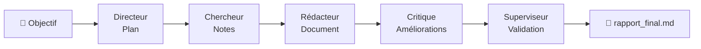

# 🧠 NEXUS AI — Organisation multi-agents autonome en local

<p align="center">
  <em>5 agents spécialisés · 1 directeur · 100 % local · 0 CHF</em>
</p>

NEXUS AI est une organisation d'agents IA autonomes qui collaborent pour accomplir un objectif donné : planifier, rechercher, rédiger, critiquer et valider un livrable. Tout tourne **en local** sur une machine Windows 11 (VM ou physique), sans abonnement ni clé API payante.


---

## 🎯 Le concept

Une entreprise fictive, entièrement composée d'agents IA :

| Agent | Rôle | Mission |
|---|---|---|
| 🎖️ **Directeur** | Chef de projet | Décomposer l'objectif en sous-tâches |
| 🔍 **Chercheur** | Analyste | Rassembler les points clés et arguments |
| ✍️ **Rédacteur** | Rédacteur professionnel | Rédiger le livrable complet |
| 🧐 **Critique** | Contrôle qualité | Identifier les faiblesses et améliorer |
| ✅ **Superviseur** | Responsable final | Valider la conformité avec l'objectif |

Les agents travaillent en pipeline séquentiel (`Process.sequential`) : chaque tâche prend en entrée le résultat de la précédente.



---

## 🧱 Pourquoi ces choix techniques

### CrewAI plutôt que LangChain / AutoGen / Agno

| Critère | CrewAI | LangChain | AutoGen | Agno |
|---|---|---|---|---|
| Modelé de pensée | **Rôles + tâches** (équipe) | Chaînes / graphes | Conversations | Agents + Teams |
| Courbe d'apprentissage | ✅ Faible | ❌ Élevée | Moyenne | ✅ Faible |
| Idéal pour un débutant | ✅✅ | ❌ | Moyen | ✅ |
| Process intégré (sequential / hierarchical) | ✅ Natif | ⚠️ Via LangGraph | ⚠️ Manuel | ✅ |

**Décision :** CrewAI a été retenu pour trois raisons :

1. **Abstraction "équipe" native** — un agent = un rôle, une tâche = un livrable, un crew = une équipe. C'est exactement le modèle mental d'une organisation, parfait pour une première approche des systèmes multi-agents.
2. **Simplicité maximale** — un premier système complet tient en ~100 lignes de Python, sans couches d'abstraction superflues.
3. **Process de coordination intégré** — `Process.sequential` et `Process.hierarchical` permettent de changer l'organisation des agents en une ligne, sans réécrire la logique.

> Agno a aussi été testé (plus rapide à l'instanciation, très bonne API `Team`). CrewAI a été préféré pour la clarté de son modèle rôle/tâche et sa documentation orientée "organisations d'agents".

### Ollama + Qwen2.5 plutôt qu'une API cloud

| Critère | Ollama (local) | API cloud (OpenAI, etc.) |
|---|---|---|
| Coût | **0 CHF** | Facturé au token |
| Confidentialité | **100 % local**, rien ne sort de la machine | Données envoyées à un tiers |
| Connexion requise | ❌ Non (après le pull) | ✅ Oui |
| Qualité / vitesse | Dépend du matériel | Supérieure |
| Clé API | **Aucune** | Obligatoire |

**Décision :** Ollama avec le modèle `qwen2.5:7b` — le meilleur compromis qualité/taille pour tourner sur une VM avec ~8 Go de RAM alloués. Aucune clé API, aucune donnée qui quitte la machine, coût nul. Le changement de modèle se fait en une ligne (`LLM(model="ollama/...")`).

---

## 📁 Structure du projet

```
NEXUS-AI/
│
├── .venv/               # Environnement Python isolé
├── agents/              # (futur) définitions d'agents séparées
├── memory/              # (futur) mémoire persistante des agents
├── workspace/            # (futur) fichiers de travail des agents
├── reports/             # Livrables générés (rapport_final.md)
├── config/              # (futur) configuration
├── main.py              # Le système multi-agents complet
├── requirements.txt     # Dépendances
└── README.md
```

---

## 🚀 Installation — de zéro à l'exécution

### Prérequis

- Windows 10/11 (fonctionne aussi sous Linux/macOS avec adaptations mineures)
- ~8 Go de RAM disponibles (le modèle 7B en a besoin)
- ~6 Go d'espace disque pour le modèle

### Étape 1 — Python

Télécharge Python 3.11 ou 3.12 sur [python.org](https://www.python.org/downloads/).
À l'installation : cocher **Add Python to PATH**.

```cmd
python --version   # doit afficher 3.10 à 3.13
```

### Étape 2 — Git

Télécharge sur [git-scm.com](https://git-scm.com/download/win), options par défaut.

```cmd
git --version
```

### Étape 3 — Ollama

Télécharge sur [ollama.com](https://ollama.com/download/windows), puis :

```cmd
ollama --version
ollama pull qwen2.5:7b
ollama run qwen2.5:7b          # test interactif, /bye pour quitter
```

Ollama sert ensuite son API en arrière-plan sur `http://localhost:11434`.

### Étape 4 — Le projet

```cmd
mkdir C:\NEXUS-AI
cd C:\NEXUS-AI
python -m venv .venv
.venv\Scripts\activate
python -m pip install --upgrade pip
pip install crewai
echo crewai > requirements.txt
python -c "import crewai; print('CrewAI fonctionne')"
```

### Étape 5 — Le code (`main.py`)

```python
from pathlib import Path
from crewai import Agent, Task, Crew, Process, LLM

# --- LLM local via Ollama ---
llm = LLM(model="ollama/qwen2.5:7b", base_url="http://localhost:11434")

# --- Agents ---
directeur = Agent(
    role="Directeur de projet",
    goal="Décomposer l'objectif en sous-tâches claires",
    backstory="Tu es un chef de projet expérimenté qui planifie avec rigueur.",
    llm=llm, allow_delegation=False, verbose=True,
)
chercheur = Agent(
    role="Chercheur d'informations",
    goal="Collecter et structurer les informations pertinentes",
    backstory="Tu es un analyste rigoureux.",
    llm=llm, verbose=True,
)
redacteur = Agent(
    role="Rédacteur",
    goal="Rédiger un contenu clair, structuré et professionnel",
    backstory="Tu es un rédacteur professionnel.",
    llm=llm, verbose=True,
)
critique = Agent(
    role="Critique qualité",
    goal="Identifier les faiblesses et améliorer le document",
    backstory="Tu es un relecteur exigeant mais constructif.",
    llm=llm, verbose=True,
)
superviseur = Agent(
    role="Superviseur final",
    goal="Approuver la version finale",
    backstory="Tu es responsable de la qualité finale.",
    llm=llm, verbose=True,
)

# --- Tâches (pipeline) ---
taches = [
    Task(description="Décompose l'objectif suivant en 3 à 5 sous-tâches : {objectif}",
         expected_output="Une liste numérotée de sous-tâches.", agent=directeur),
    Task(description="Rassemble les points clés pour chaque sous-tâche du plan.",
         expected_output="Des notes structurées par sous-tâche.", agent=chercheur),
    Task(description="Rédige le livrable complet à partir des notes, en français.",
         expected_output="Le document complet rédigé.", agent=redacteur),
    Task(description="Relis le document, liste ses faiblesses et améliore-le directement.",
         expected_output="Le document amélioré + les corrections apportées.", agent=critique),
    Task(description="Vérifie que le document final répond à l'objectif, puis valide-le.",
         expected_output="Le document final validé.", agent=superviseur),
]

# --- L'équipage ---
crew = Crew(
    agents=[directeur, chercheur, redacteur, critique, superviseur],
    tasks=taches,
    process=Process.sequential,
    verbose=True,
)

if __name__ == "__main__":
    objectif = input("🎯 Objectif pour NEXUS AI : ")
    resultat = crew.kickoff(inputs={"objectif": objectif})

    rapport = Path("reports/rapport_final.md")
    rapport.parent.mkdir(exist_ok=True)
    rapport.write_text(str(resultat), encoding="utf-8")
    print(f"\n✅ Rapport sauvegardé dans {rapport}")
```

### Étape 6 — Lancer

```cmd
cd C:\NEXUS-AI
.venv\Scripts\activate
python main.py
```

Exemple d'objectif :

> Rédige un plan pour lancer une petite entreprise de création de sites web à Genève.

Le rapport final est sauvegardé dans `reports/rapport_final.md`.

---

## 🧪 Dépannage

| Problème | Solution |
|---|---|
| Erreur de connexion au LLM | Ollama n'est pas démarré → `ollama serve` |
| `import crewai` échoue | Venv non activé → `.venv\Scripts\activate` |
| Réponses très lentes | Passer à `qwen2.5:3b` (moins de RAM) ou allouer plus de RAM à la VM |
| Résultats de mauvaise qualité | Modèle 7B local = limites connues ; envisager un modèle plus grand ou une API cloud |

---

## 🗺️ Feuille de route

- [x] v1.0 — Pipeline séquentiel 5 agents, 100 % local
- [ ] Mémoire persistante (`memory=True` dans `Crew`)
- [ ] Mode hiérarchique (`Process.hierarchical`) — le directeur délègue automatiquement
- [ ] Boucle d'amélioration (le critique itère 2×)
- [ ] Outils : recherche web (DuckDuckGo), lecture de fichiers
- [ ] Interface web (AgentOps / Streamlit)

---

## 📚 Références

- [Documentation CrewAI](https://docs.crewai.com/)
- [Ollama](https://ollama.com/)
- [Qwen2.5](https://qwenlm.github.io/)

## 📄 Licence

MIT — librement réutilisable.